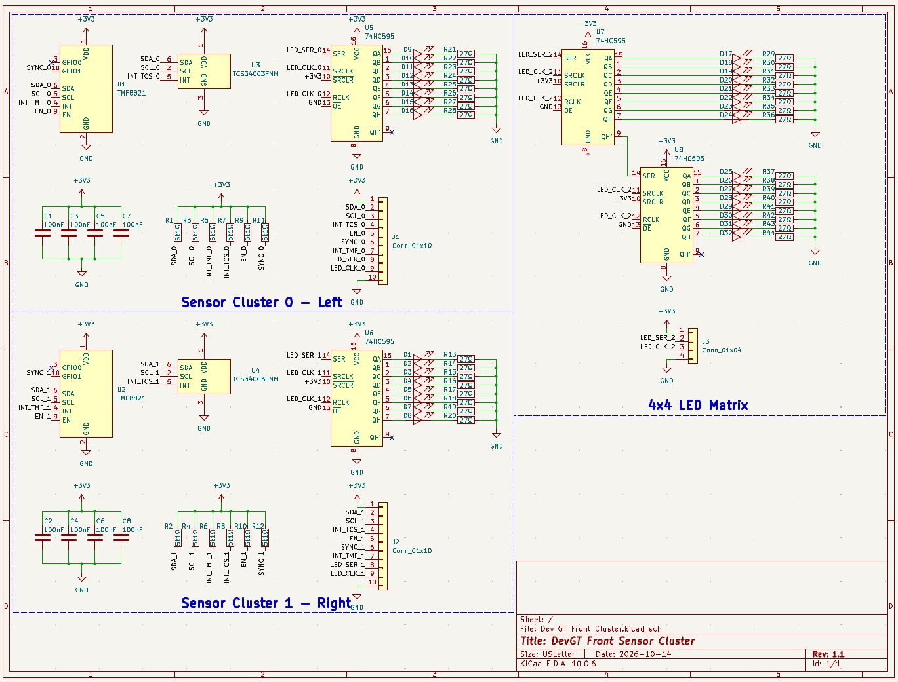
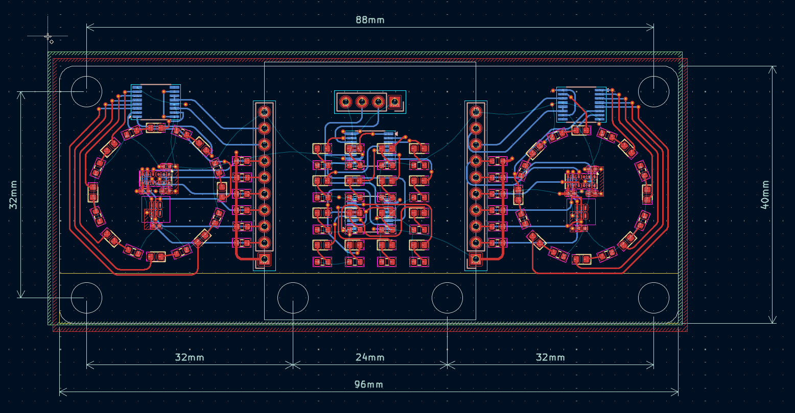

# Dev GT

Dev GT is a new local competition focused in developing programming skills by constraining the participants with stock cars. All hardware files to build your own Dev GT car are in this repository. 

## TO DO

- [ ] Front Sensor Cluster
    - [x] [Schematic](#schematics)
    - [x] [PCB](#pcbs)
    - [ ] Case
- [ ] Rear Sensor Cluster
    - [ ] Schematic
    - [ ] PCB
    - [ ] Case
- [ ] Sides Sensor Clusters
    - [ ] Schematic
    - [ ] PCB
    - [ ] Case
- [ ] Mainboard 
    - [ ] Schematic
    - [ ] PCB
    - [ ] Case
- [ ] Chassis
- [ ] Steering System
- [ ] Power Train

## Schematics

|Part | Image|
|----|----|
|[Front Sensor Cluster PDF](Schematics/Front_Sensor_Cluster) | |

## PCBs

|Part | Image|
|----|----|
|[Front Sensor Cluster PDF](PCB/Front_Sensor_Cluster_PCB) | |
